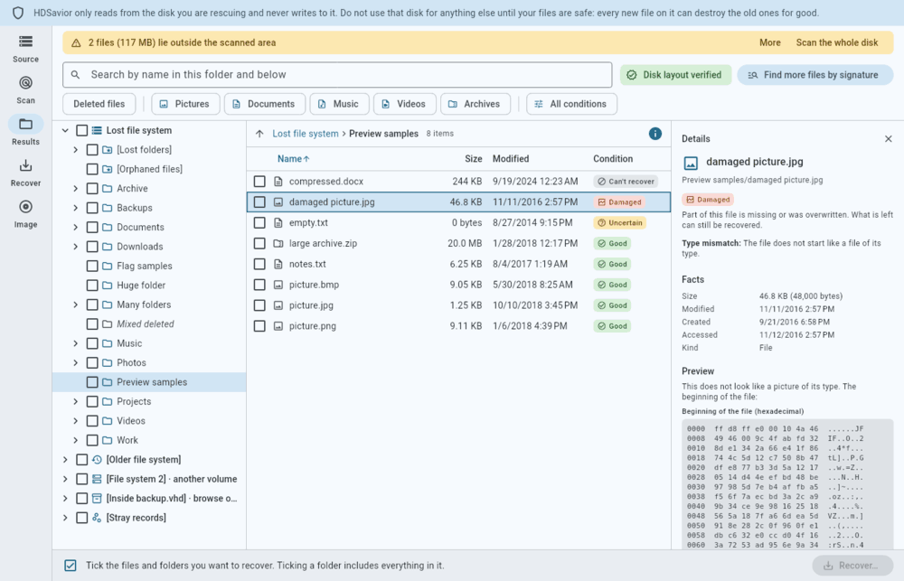
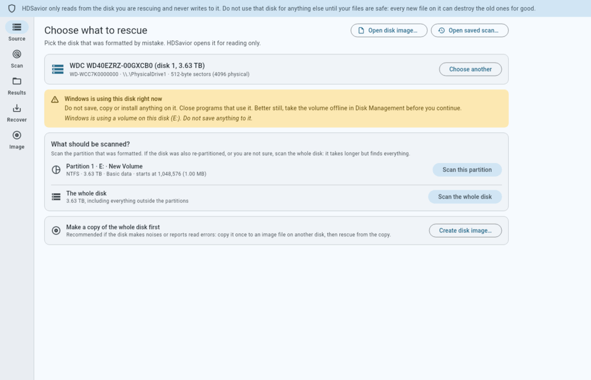
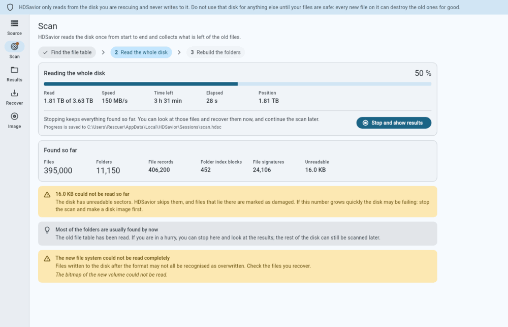
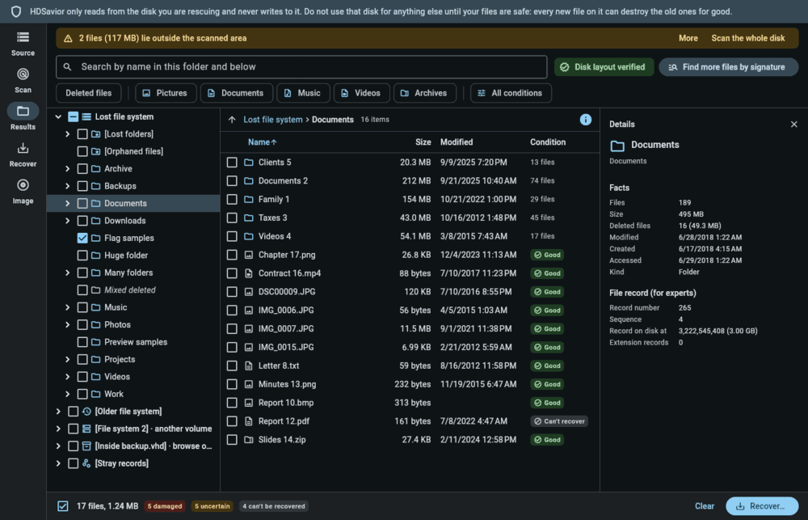
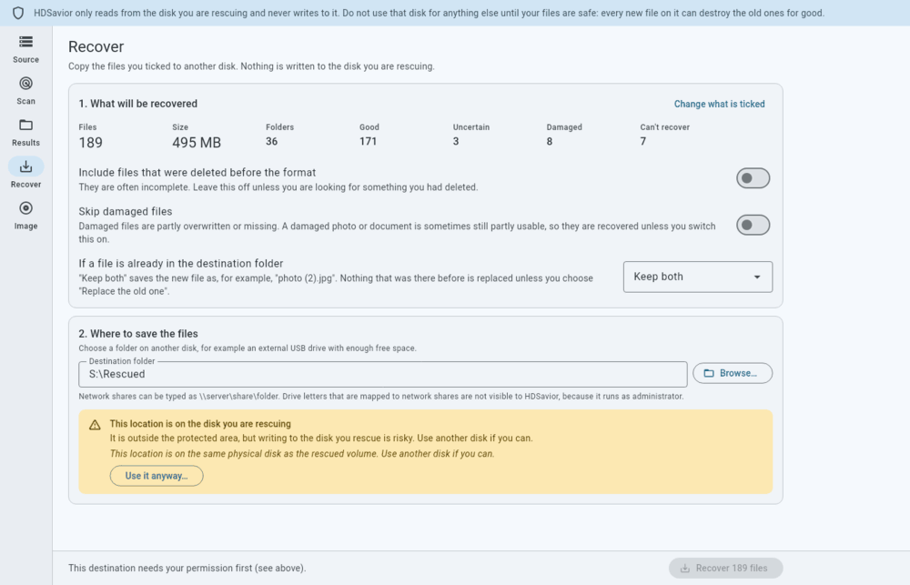
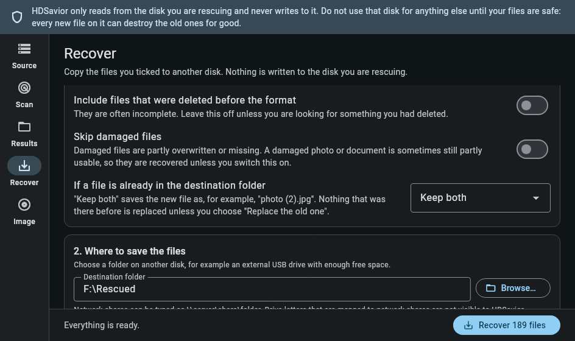
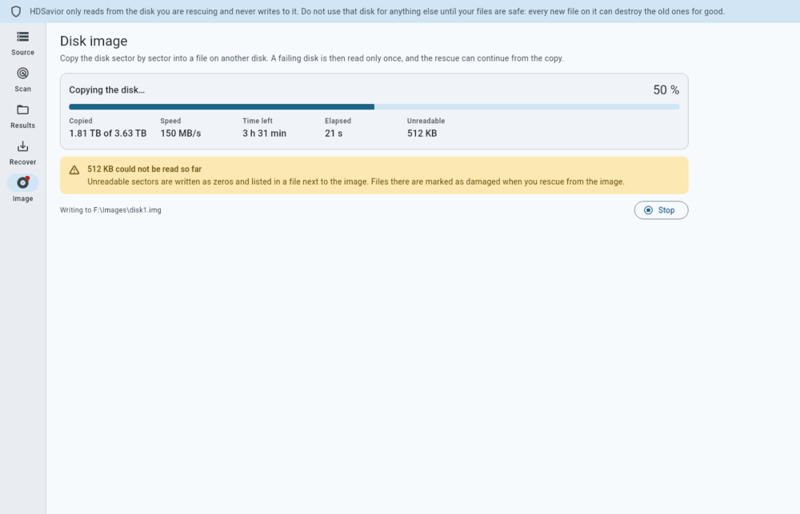

# HDSavior app

The Windows desktop UI of HDSavior (Flutter). It does no disk access of its
own: it starts `hdsavior-engine.exe serve` as a child process and talks to it
in JSON lines, as specified in [docs/PROTOCOL.md](../docs/PROTOCOL.md). The
overall design is in [docs/ARCHITECTURE.md](../docs/ARCHITECTURE.md) (sections
2, 4 and 6 concern the UI).

It holds the project and Windows runner, the engine layer, the application
state, the five screens, a fake engine for tests, and the tests.



- [The screens](#the-screens)
- [Build and run](#build-and-run)
- [Running without the real engine](#running-without-the-real-engine)
- [Architecture](#architecture)
- [Engine layer](#engine-layer-libengine)
- [State layer](#state-layer-libstate)
- [UI layer](#ui-layer-libui)
- [Tests](#tests)
- [Screenshots](#screenshots)
- [Dependencies](#dependencies)

## The screens

One window: the permanent safety notice on top, the navigation rail on the
left (a dot marks the screen whose job is running), the screen on the right.
Every screen works down to the smallest window (960 x 600 including the
frame, about 944 x 561 for the app) without clipping text.

| screen | what the user does there |
|---|---|
| **Source** | Disk cards from `list_disks` (model, size, bus, the volumes Windows shows, badges for the system disk, TRIM, SSD, removable, virtual, Storage Spaces, dynamic, no medium), ordinary disks first. "Choose this disk" opens it read-only (`open_source`): the real partition table and the engine's warnings in plain words (red for what can cost files: TRIM, system disk, page file, the app on the source, a source that reads as zeros; amber for the rest), then "Scan this partition", "Scan the whole disk" or "Create disk image…". "Open disk image…", "Open saved scan…" (`session_load`; without its disk: a browse-only banner and "Attach the disk…"), refresh, the last session after an engine crash, empty states for no disks / not elevated / not Windows. |
| **Scan** | The three phases as steps, progress, speed, time left, elapsed, position, counters, unreadable bytes, warnings as they arrive, the hint once the phase changes to `sweep`, "Stop and show results" with what stopping means (disabled while the folders are rebuilt). The session file is chosen automatically in the app's session directory (model, serial, range start, local time) and checked with purpose `session`; if the guard refuses it, the user picks a folder (with the consents) or scans without saving. A scan that ends with results shows the Results screen; `source_lost` offers "Reconnect and continue" (attach, then resume). |
| **Results** | Left the file systems (main first and open; older, other volumes, inside an image file, stray records, each labelled) as a lazily paged tree; the paged file table (name, size, modified, condition; fixed row height; loading placeholders); the details pane (path, sizes, dates, every flag explained, record facts, preview: pictures, text or hex). Search (sent after a pause in typing, results with their folder, tickable), filters (deleted files, file types, condition), the disk-layout chip (evidence, candidates, manual setting), "this is the one I want" / "treat as a separate volume" / "undo my choice", "Find more files by signature" with progress, the notices of the catalog with their actions (continue the scan, scan the whole disk, attach the disk, save the scan elsewhere), and the selection bar ("17 files, 1.24 MB, 5 damaged" and "Recover…"). Keyboard: arrows, Page Up/Down, Home/End, Space ticks, Enter opens; in the tree Right/Left open and close. |
| **Recover** | What will be recovered (from `selection_summary`), the options (deleted files, skip damaged, what to do with existing files), the destination (picker or typed, UNC included; the hint that mapped drive letters are invisible to an elevated program) with the engine's live verdict, the lost files at that location, free space and the FAT32 file-size limit; separate consent dialogs for `same_disk` and `unknown_disk` (a tick box, the safe button as default, void when the path changes); the start button always in view with the reason why it is disabled; progress with the current file and counts by outcome; the outcome with "Open folder" and "Open report" (if no program can be started, the path is shown with "Copy path"). |
| **Image** | Whole disk, one partition, or the scanned area; the image file (save dialog with a suggested name) with the guard's verdict and consents; an existing file is never overwritten, continuing it is offered; progress with unreadable bytes; "Rescue from this image" when done. |

Errors are shown in plain language with the engine's own message and a
"Technical details" button (code, request, message, copyable). An engine
that dies replaces the screens with an explanation and "Start the engine
again"; long requests (`session_load`, `geometry_set`) show their progress
over the screens.

| | |
|---|---|
|  |  |
|  |  |
|  |  |

## Build and run

Requirements: Windows 10 or 11, Flutter 3.50.1 (Dart 3.14), Visual Studio 2022
with the "Desktop development with C++" workload, and a Rust toolchain for the
engine.

```powershell
# 1. The engine (once, and whenever it changes)
cd engine
cargo build --release              # -> engine\target\release\hdsavior-engine.exe

# 2. The app
cd ..\app
flutter pub get
flutter build windows              # -> build\windows\x64\runner\Release\hdsavior.exe
```

**`flutter run` must be started from an elevated terminal** ("Run as
administrator"). The app's manifest requests administrator rights
(`requireAdministrator`), because reading raw disks needs them; Windows
refuses to start such a program from a process that is not elevated itself
(error 740, "The requested operation requires elevation"), and `flutter run`
starts the program directly. Double-clicking `hdsavior.exe` shows the UAC
prompt instead.

### How the engine gets into the bundle

`windows/CMakeLists.txt` has an install rule that copies the engine next to
`hdsavior.exe` on every `flutter build windows` / `flutter run`. It takes the
first of these that exists:

1. the file named by the environment variable `HDSAVIOR_ENGINE_EXE`
   (whatever its file name; it is installed as `hdsavior-engine.exe`),
2. `..\engine\target\release\hdsavior-engine.exe`.

If neither exists the build still succeeds and prints a CMake warning; the app
then starts and explains that the engine was not found.

### How the app finds the engine at run time

`locateEngineExecutable()` (lib/engine/engine_locator.dart):
`hdsavior-engine.exe` in the directory of the app's own executable. In a
debug or profile build (`flutter run`), the value of the environment
variable **`HDSAVIOR_ENGINE`** wins if it is set. A release build ignores
it: the app runs elevated, and a user environment variable can be set by any
program without elevation.

### What was changed in the generated Windows runner

- `runner/runner.exe.manifest`: `requestedExecutionLevel
  level="requireAdministrator"`. `runner/CMakeLists.txt` passes
  `/MANIFESTUAC:NO` to the linker so that its default `asInvoker` fragment does
  not collide with the manifest (two different levels cannot be merged:
  mt.exe error c1010001).
- `runner/main.cpp`: window title `HDSavior`; default size 1280x800 logical
  pixels, shrunk to the work area and centred on the primary monitor; minimum
  size 960x600.
- `runner/win32_window.{h,cpp}`: `SetMinimumSize` and the `WM_GETMINMAXINFO`
  handler (scaled by the monitor's DPI, never larger than its work area).
- `runner/Runner.rc`: product name and file description `HDSavior` (the name
  the UAC prompt shows).
- `CMakeLists.txt`: the engine install rule.

Only the `windows/` platform folder is committed. `linux/` is git-ignored.

## Running without the real engine

`test/fake_engine/` holds a fake engine written in Dart: the whole protocol
over a generated world (seven disks, a tree of up to several hundred thousand
nodes with every rating and flag, five file systems of every kind, protected
lost volumes, jobs with progress, refusals and failures). It is what the
tests run against, and it can drive the app:

```powershell
flutter run -d windows -t test/fake_engine/run_app.dart
```

It can also stand in for the engine executable, since it speaks the protocol
on its standard streams (`test/fake_engine/serve.dart`; environment
`FAKE_ENGINE_NODES`, `FAKE_ENGINE_TICK_MS`). It is pure Dart, so it compiles
to a native executable that `HDSAVIOR_ENGINE` can point to directly (a `.bat`
wrapper would not do on Windows: the app starts the engine without a shell):

```powershell
dart compile exe test\fake_engine\serve.dart -o $env:TEMP\fake-engine.exe
$env:HDSAVIOR_ENGINE = "$env:TEMP\fake-engine.exe"
$env:FAKE_ENGINE_TICK_MS = "250"             # jobs advance four steps a second
flutter run -d windows                       # the real main.dart, fake engine as a child process
```

Behaviour is selected by names, so it can be triggered from the running app.
The full table is at the top of `test/fake_engine/fake_world.dart`; the most
useful entries:

| type this                                  | to get                                   |
|--------------------------------------------|------------------------------------------|
| destination on `E:\` (the rescued disk)    | `overlaps_source`, reason `session_range` (always refused) |
| destination on `L:\`                       | inside the lost volume of the main file system: `overlaps_source`, reason `lost_volume`, with `lost_files`; `same_disk` while no catalog knows that volume |
| destination on `S:\` / `U:\`               | `same_disk` / `unknown_disk` (consent)   |
| destination on `Q:\`, `R:\`, `relative`    | `not_found`, `not_writable`, `invalid_path` |
| destination on `T:\` / `K:\`               | only 1 MiB free / FAT32 (4 GiB limit)    |
| `FakeScript.scanBadBytesPerStep`, `scanWarnings` | unreadable bytes and warnings in `scan_progress` |
| the image file that is the source          | `overlaps_source`, reason `source_image` |
| scan disk 2's `D:`, then a destination on `F:` | the old volume reached into `F:`: `lost_volume` |
| image file `...\missing.img`, `denied.img` | `not_found`, `access_denied`             |
| an image or session file named `*mixed*`   | the catalog warning `mixed_generations`  |
| session file `...\detached.hdsc`           | loads without its disk (browse only)     |
| session file `...\partial.hdsc`            | a stopped scan that can be resumed       |
| a session path on `F:` for a scan of disk 2's `D:` | `same_disk` at the start; once the catalog shows the lost volume there, the warning `session_file_at_risk` |
| image destination `...\exists.img`         | `exists`                                 |

As the real engine does, `list_disks` describes the volumes Windows exposes
(Windows' partition numbers, the mounted file system or `null`, no type, no
NTFS details, nothing for partitions without a volume), and `open_source`
the partition table read from the disk. A disk card can only show the
former.

Two choices of the fake that the protocol leaves open, so that a screen
must not depend on them: before any session exists (state O) the guard
treats the whole source as protected, because the next scan or image covers
all of it unless told otherwise; and `Instance.id` is the instance's position
in `CatalogInfo.instances` (main = 0), so the ids change when `instance_set`
chooses another main file system. Take instance ids from the current catalog
only.

On Linux (the app itself is Windows-only, but everything except the runner
runs anywhere): make a scratch copy, add the platform folder there, and run
under Xvfb.

```sh
cp -r app /tmp/hdsavior-app && cd /tmp/hdsavior-app
flutter create --platforms=linux --org com.hdsavior --project-name hdsavior .
flutter build linux --debug -t test/fake_engine/run_app.dart
xvfb-run -a build/linux/x64/debug/bundle/hdsavior
```

## Architecture

```
lib/
  main.dart            entry point: process transport + platform services
  app.dart             HdSaviorApp: MaterialApp, starts the engine, shuts it down on exit
  engine/              the protocol as Dart types; no Flutter imports
  state/               application state: ChangeNotifiers on top of the engine layer
  platform/            PlatformServices (OS-specific bits) and FilePickers (dialogs), both interfaces
  ui/                  the shell, the five screens, strings, formats, theme (see "UI layer")
test/
  fake_engine/         the fake engine (pure Dart) and its transport
  support/             FakeApp (state layer on the fake), ScriptedTransport (byte-level),
                       RecordingTransport / ReplayTransport (transcripts),
                       stand-ins for the OS services and the dialogs
  data/                the JSON examples of PROTOCOL.md, verbatim
  engine/ state/ ui/ platform/   the tests
```

Rules the code follows:

- **The UI holds no file data.** Rows are fetched from the engine in pages on
  demand and kept in a bounded cache; a folder with a million files costs a
  few pages of memory. Checking a folder stores one id.
- **The engine is the authority.** The app never decides by itself whether a
  destination is safe, what is selected in a subtree, or whether a job may
  start; it asks, and shows the engine's answer and message.
- **Nothing in `lib/` uses `dart:ffi` or Win32.** OS-specific behaviour
  (default session directory, opening a folder) is behind `PlatformServices`
  and built on `dart:io` only, so tests and the app itself run on Linux. The
  file and folder dialogs are behind `FilePickers` (`app.pickers`:
  `pickFile`, `pickSavePath`, `pickFolder`), implemented with the
  `file_selector` plugin. Tests use the stand-ins of
  `test/support/fake_platform.dart` (`ScriptedFilePickers`,
  `InertPlatformServices`).
- **The app writes nothing of its own into the protected ranges**
  (ARCHITECTURE S2): whenever a source is opened, and again whenever a
  catalog arrives or goes away, a geometry is set or the file systems change
  (`catalog.guardRevision`), it asks `check_destination` with purpose
  `app_data` for its session directory and creates it only on verdict `ok`
  (`SourceController.canWriteAppData`, `ensureSessionDirectory`).
- **State management is the SDK's `ChangeNotifier` / `ValueNotifier`**, no
  package. The state is a handful of long-lived controllers created in one
  place (`AppController`); widgets listen with `ListenableBuilder`. That is
  all the app needs, it keeps the controllers plain Dart objects that the
  tests drive without widgets, and it adds no dependency.

### What a screen does

```dart
class ScanScreen extends StatelessWidget {
  const ScanScreen({super.key, required this.app});
  final AppController app;

  @override
  Widget build(BuildContext context) => ListenableBuilder(
    listenable: app.scan,                       // any controller is a Listenable
    builder: (context, _) => Text('${app.scan.phase} ${app.scan.progress?.fraction}'),
  );
}
```

Calls that talk to the engine return futures that fail with an
`EngineException`; `e.kind` is the typed error code and `e.message` the
engine's plain-language text:

```dart
try {
  await app.recover.start(dest: path);
} on EngineException catch (e) {
  // e.kind == EngineErrorCode.destinationRefused: app.recover.destinationCheck
  // now holds the verdict and its message. EngineErrorCode.busy, noSpace, ...
}
```

`AppController.screen` (a `ValueNotifier<AppScreen>`) says which of the five
screens the shell shows (see [UI layer](#ui-layer-libui)).

## Engine layer (`lib/engine`)

Import `package:hdsavior/engine/engine.dart`.

| class | role |
|---|---|
| `EngineTransport`, `EngineConnection` | Interface to "something that starts an engine and gives its standard streams". `ProcessEngineTransport` is the real one (`hdsavior-engine serve`); tests use `FakeEngineTransport` and `ScriptedTransport`. |
| `EngineClient` | Owns the process. Frames JSON lines (UTF-8, `LineSplitter`; lines of many megabytes are fine), matches responses to requests by id, publishes events (`events`, `on<T>()`), reports the end of the process (`exits`) and fails pending requests with `engine_exited`. `start`, `restart`, `shutdown` (shutdown command, end of input, kill as last resort), `kill`. |
| `EngineApi` | One typed method per protocol command: `hello`, `listDisks`, `openSource`, `closeSource`, `scanStart`, `jobCancel`, `sessionSave`, `sessionLoad`, `sessionAttachSource`, `catalogInfo`, `geometrySet`, `instanceSet`, `listChildren`, `nodeInfo`, `search`, `selectionSummary`, `checkDestination`, `recoverStart`, `carveStart`, `imageStart`, `readFile`, `shutdown`; plus `readFileContent` (a file's first N bytes in small chunks, cancellable: for previews). |
| `EngineException` | The one exception type of failed requests: `code`/`kind`, `message`, `data`, `command`; `destinationCheck` for `destination_refused`; `isEngineGone`. Client-side kinds: `engineExited`, `engineNotRunning`, `engineStartFailed`, `protocolError`. |
| `CancelToken`, `RequestCancelledException` | Client-side cancellation of requests (see below). |
| objects.dart | `SourceInfo`, `Partition`, `NtfsBootInfo`, `Disk`, `Warning`, `Geometry`, `Instance` (with `manual`), `InstanceVirtual`, `LiveVolume`, `ByteRange`, `ProtectedRange` (`CatalogInfo.protected`), `CatalogInfo`, `NodeRow` (PROTOCOL `Row`), `FileFilter` (PROTOCOL `Filter`), `EngineError`. |
| results.dart | `HelloResult`, `OpenSourceResult`, `ScanStartResult`, `SessionSaveResult`, `SessionLoadResult`, `SessionAttachResult`, `RowsPage`, `NodeInfo` (`NodeRef`, `RecordInfo`, `DataInfo`, `FlagDetail`), `SelectionSummary`, `DestinationCheck` (with `reason`, `lostFiles`, `lostBytes`), `RecoverStartResult`, `CarveStartResult`, `ImageStartResult`, `ReadFileResult`, `SourceRef`. |
| events.dart | `EngineEvent` (sealed): `ScanProgress`, `ScanDone`, `RecoverProgress`, `RecoverDone`, `CarveProgress`, `CarveDone`, `ImageProgress`, `ImageDone` (grouped as `JobProgressEvent` / `JobDoneEvent`), `TaskProgress`, `LogEvent`, `UnknownEvent`, `MalformedEvent`. |
| enums.dart | Every closed set of strings, each value with its wire name (`.wire`), among them `InstanceOverride` (`instance_set`: `main`, `other`, `auto`) and `ProtectionReason` (`session_range`, `lost_volume`, `source_image`). |

Conventions of the models:

- Immutable; `fromJson(JsonObject)` ignores unknown members and throws a
  `ProtocolFormatException` naming the member (`list_children.rows[3].size: is
  missing`) when a documented member is missing or mistyped. Through
  `EngineApi` that surfaces as an `EngineException` of kind `protocolError`.
- Byte counts, offsets and ids are Dart `int`s (64-bit: the app only runs on
  the VM). Timestamps stay Unix milliseconds (`int?`), with `timeFromMs` and
  `NodeRow.modifiedTime` for display.
- A string this version does not know (a rating, flag, warning code or error
  code of a newer engine) parses to the enum's `unknown` value; the original
  text stays available (`Warning.code`, `NodeRow.flagNames`,
  `EngineException.code`).
- Names that differ from the document: `Row` is `NodeRow` (Flutter has a
  `Row`), `Filter` is `FileFilter`, `offset_source: "index"` is
  `OffsetSource.indexVotes` and `"default"` is `byDefault` (reserved words).
- `DestinationCheck` is read leniently: only `verdict` is required, because
  what the engine knows about a location depends on the verdict (nothing at
  all for `invalid_path`), and an unreadable refusal would hide the engine's
  explanation. Missing counts read as 0, missing texts as empty.

Requests and cancellation: the engine handles requests strictly one after the
other, so the client keeps one request at the engine and queues the rest
itself. A request made with a `CancelToken` that is cancelled while it is
still queued is never sent; one that was already sent completes at once with
`RequestCancelledException` and its answer is dropped. `jobCancel` jumps the
queue.

## State layer (`lib/state`)

Import `package:hdsavior/state/state.dart`. `AppController` creates and wires
everything; its fields are the public surface for the screens.

| field | class | what it holds |
|---|---|---|
| `engine` | `EngineController` | `status` (`stopped`, `starting`, `ready`, `incompatible`, `failed`), `hello`, `error`, `lastExit` (with the tail of the engine's log); `start`, `restart`, `shutdown`. |
| `source` | `SourceController` | `disks` / `refreshDisks`; `current` (`OpenedSource`: info, table, partitions, warnings, `attached`, `attachError`), `revision`; `openDisk`, `openImage`, `close`, `loadSession`, `attachSource`, `saveSession`; `sessionPath`; `appDataCheck`, `canWriteAppData`, `ensureSessionDirectory`, `suggestSessionPath({range, now})` (model, serial, range start, local time), `prepareSessionFile({range})` (checks the proposed file with purpose `session` and creates the session directory only on `ok`), `checkSessionFile(path)`. |
| `catalog` | `CatalogController` | `info` (`CatalogInfo`), `epoch`, `sourceAttached`, `protectedRanges`, `guardRevision`, `epochChanges`; `refresh`, `guarded`, `nodeInfo`, `readContent`, `setGeometry`, `setInstanceKind`; owns `selection` and `rows`. |
| `selection` | `SelectionModel` | The include/exclude sets: `setChecked`, `toggle`, `stateOf`, `isSelected`, `clear`, `include`, `exclude`, `spec`. |
| `catalog.rows` | `RowCache` | `open(RowQuery)` -> `PagedRows`. |
| `browse` | `BrowseController` | `folder` (`FolderLocation`), `filters` (`ViewFilters`), `sort`, `descending`, `sortBy`, `open`, `openRoot`; `rows` (the table), `folders(node)` (the tree), `ancestorsOf(row)`. |
| `scan` | `ScanController` | `start`, `resume`, `stop`; `scanPhase`, `canStop`, `warnings` (those of the progress events, each once); plus the job members below. |
| `recover` | `RecoverController` | `options` (`RecoverOptions`), `summary` (follows the selection), `destination` (a `DestinationChecker`; also as `checkDestination`, `checkedDestination`, `destinationCheck`, `destinationError`, `isCheckingDestination`), `allows`, `readyToStart`, `start`, `jobDestination`; plus the job members. |
| `carve` | `CarveController` | `hasCarveHits`, `start(kinds)`; plus the job members. |
| `image` | `ImageController` | `destination` (a `DestinationChecker`, with the same shortcuts), `allows`, `start`, `jobDestination`; plus the job members. |
| `jobs` | `JobTracker` | `value`: which job is active (`JobKind?`); the engine runs one at a time. |
| `task` | `ValueNotifier<TaskProgress?>` | Progress of a long plain request (`session_load`, `geometry_set`). |
| `screen` | `ValueNotifier<AppScreen>` | The screen the shell shows. |
| `platform` | `PlatformServices` | `defaultSessionDirectory`, `createDirectory`, `openFolder` (show the recovered files in Explorer), `openFile` (open the report with its program). |
| `pickers` | `FilePickers` | The open, save and folder dialogs. |
| `api`, `client` | `EngineApi`, `EngineClient` | Direct access to the engine for what no controller wraps (for example `checkDestination` with purpose `session`), and the `log` events (`app.log`). |

### Jobs

`ScanController`, `RecoverController`, `CarveController` and `ImageController`
extend `JobController<Start, Progress, Done>`:

- `phase`: `idle` -> `starting` -> `running` (-> `cancelling`) -> `done`.
- `started` (the answer to `*_start`), `progress` (the latest progress event),
  `result` (the done event), `status` (`completed`, `stopped`, `cancelled`,
  `failed`), `failure` (why it failed: the done event's error, or
  `engine_exited` / `protocol_error`), `startError` (why a start was refused;
  for `destination_refused` its `destinationCheck` says why).
- `cancel()` sends `job_cancel`; the job then ends with its done event.
  A cancel while the start is still unanswered is held back
  (`cancelPending`) and sent as soon as the engine has accepted the job:
  `job_cancel` jumps the client's queue, so sent at once it could reach the
  engine before the start command and be answered as "no job".
  `reset()` dismisses a finished job.

What happens around a job is wired already: a scan clears the catalog when it
is accepted and adopts the new one when it is done; carving keeps the epoch
and drops ticked carved files; a recovery refreshes the rows afterwards;
`source_lost` marks the source as no longer attached; the death of the engine
ends the job with `engine_exited`.

### Catalog, epochs, rows

Node ids are valid for one catalog epoch. `CatalogController` enforces that on
the client side: when a catalog with a new epoch arrives (or the catalog goes
away) the selection is cleared and every `PagedRows` is closed; when the epoch
stays but rows may have changed (carving, a new geometry, a recovery) the rows
are fetched again and the selection is kept. A `stale_catalog` answer to any
request made through `catalog.guarded` triggers `catalog.refresh()`.

`catalog.setInstanceKind(instance: id, kind: InstanceOverride.main)` is the
user's "this is the one I want" (the previous main file system becomes
`other`), `InstanceOverride.other` is "treat as a separate volume" (an
`embedded` or `older` file system whose files are then read with its own
geometry and can be recovered), `InstanceOverride.auto` withdraws the choice
(`Instance.manual` says whether there is one). It starts a new epoch: the
selection is cleared and the browser returns to the root of the main file
system, which may now be another one. `strays` cannot be changed.

`catalog.guardRevision` changes whenever the destination guard may answer
differently: a catalog arrived or went away, a new epoch, other protected
ranges (`catalog.protectedRanges`, PROTOCOL `CatalogInfo.protected`), or a
geometry was set. The source controller asks again about its session
directory then, and the recover and image controllers about their
destinations.

A list widget uses a `PagedRows` like this:

```dart
ListenableBuilder(
  listenable: Listenable.merge([app.browse, app.selection]),
  builder: (context, _) {
    final rows = app.browse.rows;               // null without a catalog
    if (rows == null) return const SizedBox();
    return ListenableBuilder(
      listenable: rows,                         // rebuilds when pages arrive
      builder: (context, _) {
        rows.load();                            // learn `total` if unknown
        return ListView.builder(
          itemCount: rows.total ?? 0,
          itemExtent: 28,
          itemBuilder: (context, index) {
            final row = rows.rowAt(index);      // null while its page loads
            if (row == null) return const SizedBox(height: 28);
            final ancestors = app.browse.ancestorsOf(row);
            return CheckboxListTile(
              tristate: true,
              value: switch (app.selection.stateOf(row.id, ancestors)) {
                CheckState.checked => true,
                CheckState.unchecked => false,
                CheckState.partial => null,
              },
              onChanged: (_) => app.selection.toggle(row.id, ancestors),
              title: Text(row.name),
            );
          },
        );
      },
    );
  },
)
```

`rowAt` may be called during a build; it never notifies synchronously. Pages
have a fixed size (200 rows), at most 64 pages are kept across all lists
(least recently used first out), and requests that scrolling has left behind
are cancelled. A page that failed is not requested again until `retry()`;
`rows.error` says why.

`BrowseController.rows` is the table: the children of the current folder
(`list_children`), or, as soon as the filters contain a name or a size, the
matching files of the whole subtree (`search`; those rows carry `path` and
`ancestorIds`). `BrowseController.folders(node)` is one level of the tree
(folders only). Both are replaced when what they show changes.

### Selection

`SelectionModel` is exactly PROTOCOL's rule: *a node is selected when its
nearest ancestor-or-self that appears in `include` or `exclude` is in
`include`*. The model never needs a folder's content; what it needs for every
node it is asked about is the node's **ancestor ids, root first, without the
node itself**: `FolderLocation.childAncestors` for rows of a folder listing
(`app.browse.ancestorsOf(row)` does it), `NodeRow.ancestorIds` for search
rows, `NodeInfo.ancestorIds`, `const []` for an instance root. The sets are
kept minimal, so `stateOf` (tri-state) costs O(depth) and checking a folder is
one entry however much it holds. `RecoverController.summary` follows the
selection and the options automatically.

### Destinations

`recover.checkDestination(path)` / `image.checkDestination(path,
needBytes:)` ask the engine's destination guard. The verdict is kept current
by a `DestinationChecker` (`recover.destination`, `image.destination`):

- `check` is the verdict, `null` while it is not known (being asked, no
  catalog or no source attached, or the check failed: `error`). Never show an
  older "ok" as if it were current.
- It is asked for again by itself when the guard may answer differently
  (`catalog.guardRevision`, another source for the image) and, for a
  recovery, when the space the selection needs changes (so that
  `enoughSpace` stays true to it).
- A newer check overtakes an older one. A re-check of the same path answers
  for the check it overtook; a check of another path makes the older one
  fail with `RequestCancelledException` (nothing to show).
- `reason` says why a location is refused for good: `sessionRange` (inside
  the scanned or imaged range), `lostVolume` (inside a lost file system that
  reaches beyond the scanned range: scanning the whole disk reaches those
  files, and the destination has to be on another disk), `sourceImage` (the
  image file that is the source). `lostFiles` / `lostBytes`: catalog files
  stored where the location's volume is.

`recover.allows(check)` says whether a start can succeed with the consents in
`recover.options` (`allowSameDisk`, `allowUnknownDisk`; `overlaps_source` can
never be allowed); `image.allows(check, allowSameDisk:, allowUnknownDisk:)`
the same for an image. `recover.readyToStart` combines what the UI can know
(no job, a catalog with its source, something selected, an allowed
destination with enough space). The engine checks again at start and its
refusal becomes the verdict (`destination.adoptRefusal`). Paths are typed or
come from `app.pickers`; UNC paths are allowed (mapped drive letters are
invisible to an elevated program).

### When the engine dies

`engine.status` becomes `failed`, `engine.lastExit` carries the exit code and
the tail of the engine's log, running jobs end with `engine_exited`, and
source, catalog, selection and rows are reset (the engine's state died with
it). `app.restartEngine()` starts a fresh one; `source.sessionPath` still
names the last session file, which can be loaded again.

## UI layer (`lib/ui`)

```
app_shell.dart        navigation rail, SafetyNotice, TaskOverlay, EngineStatusView; a scan with results shows Results
strings.dart          S: every text the user sees (functions for texts with values), for translation later
format.dart           Formats: sizes in binary units as Explorer shows them, counts, local dates, durations
theme.dart            AppTheme (Material 3, light and dark from one seed), StatusColors, NoticeLevel
flows.dart            startScan (automatic session file, purpose "session", else the user's folder), resumeScan,
                      openImageFile, openSessionFile, saveSessionElsewhere, attachSourceFlow, confirm, openPath
widgets/common.dart   ScreenFrame (title, purpose, actions, sticky footer), Notice, EmptyState, Section, Figure(s),
                      FactRow, StatusChip
widgets/errors.dart   ErrorDescription, ErrorNotice, TechnicalDetailsButton, showErrorDialog, attempt
widgets/destination.dart  DestinationField, VerdictView, Consents, askSameDiskConsent, askUnknownDiskConsent
results/              folder_tree.dart (FolderTree: the paged tree flattened to fixed-height lines), results_model.dart
                      (what the Results screen remembers), tree_view.dart, file_table.dart, details_pane.dart
                      (with FilePreview), geometry_dialog.dart, file_types.dart (type groups and icons)
screens/              source_screen.dart, scan_screen.dart, results_screen.dart, recover_screen.dart, image_screen.dart
```

Conventions:

- **Texts** come from `S` only; a widget contains no English literal.
  Engine messages are shown as the engine wrote them, after a headline of
  ours (`S.errorHeadline`, `S.warningHeadline`, `S.verdictHeadline`).
- **Dates and numbers** use the user's regional format (`main.dart` loads
  it with `Formats.forLocale`); widget tests use `en_US`.
- **The Results screen keeps its state** (tree expansions, the file in the
  details pane, the search text) in a `ResultsModel` owned by the shell, so
  leaving the screen and coming back finds it as it was. What belongs to an
  old epoch is dropped with it.
- **Long lists** (tree and table) are `ListView.builder`s with a fixed item
  extent over `PagedRows`; nothing is fetched for rows that are not on
  screen. A click selects at once; a second click within 500 ms opens.
- **The engine decides**: the screens never judge a destination themselves;
  they show the verdict and offer only the consent the verdict allows.
  Consents belong to one path and are withdrawn when it changes.
- **Ticking deleted files**: turning on "Deleted files" in the Results
  filters also turns on "Include files that were deleted before the format"
  for the recovery (the Recover screen shows and can change it).

## Tests

```sh
flutter analyze        # must report no issues
flutter test           # must pass; three tests report "skipped" until the real engine is there
                       # (the conversation with the real engine, and its transcript read and replayed)
```

| where | what it proves |
|---|---|
| `test/engine/protocol_examples_test.dart` | Every JSON example of PROTOCOL.md (verbatim copies in `test/data/protocol_examples.txt`, checked against the document for drift in both directions) parses; every documented member is read and has the documented value; unknown members are ignored; any missing or mistyped member gives a `ProtocolFormatException` and nothing else. |
| `test/engine/engine_api_test.dart` | Each API method sends the documented command with exactly the documented argument names and defaults. |
| `test/engine/engine_client_test.dart` | Framing (split at every byte, merged chunks, an 11 MB line), id matching, event order, error mapping, cancellation, engine exit, restart, shutdown and kill. |
| `test/engine/process_transport_test.dart` | The real process transport against the fake engine running as a child process. |
| `test/engine/protocol_transcript_test.dart` | Reads `docs/protocol-examples.jsonl` (the transcript the real engine records) as soon as it exists. |
| `test/engine/replay_test.dart` | Records a conversation with the fake engine (`RecordingTransport`) and plays it back through a fresh `EngineClient` (`ReplayTransport`, test/support/replay_transport.dart): every answer reaches its caller with the caller's id, readable by the typed models, events in order. Plays back `docs/protocol-examples.jsonl` the same way as soon as it exists. |
| `test/engine/engine_conformance_test.dart` | One whole conversation (open an image, scan, browse, summarise, read, recover, overrule a file system, shut down) asserting only what PROTOCOL.md guarantees. Always against the fake engine as a process; against the real engine when `HDSAVIOR_ENGINE` and `HDSAVIOR_TEST_IMAGE` are set. |
| `test/fake_engine/fake_engine_test.dart` | The fake itself: the errors-by-state table, epochs, sort order, filters, aggregates, selection semantics against brute force, jobs, `instance_set`, protected ranges and the guard's reasons. |
| `test/state/*` | The selection model against a naive model on random trees; the row cache; the destination checker; every controller and job against the fake engine, step by step (including `instance_set`, re-checks when the catalog changes, and a cancel that must not overtake its start). |
| `test/platform/*` | Session directory, opening a folder, the dialogs. |
| `test/ui/app_shell_test.dart` | The shell: notice, navigation, engine failure, a scan with results showing Results (a failed one staying), the progress of long requests, clean shutdown on exit. |
| `test/ui/source_screen_test.dart` | Disk cards, their order and badges; opening a disk (table, warnings, gravest first); a scan with the automatic session file; a refused session place leading to the user's folder with the same-disk consent; scanning without saving; a refused `scan_start`; not elevated; no disks; a failed disk list; images; saved scans, browse only, attaching (also forced); the last session after a crash. |
| `test/ui/scan_screen_test.dart` | Progress, phases, counters; bad sectors and warnings as they arrive; stop and show results; reconnect and resume after `source_lost`; other failures; the idle states; resuming a stopped session. |
| `test/ui/results_screen_test.dart` | The tree and its labels; tri-state ticks in tree, table and selection bar; sorting; opening folders by double click, path and "up"; details and flag texts; previews (picture, text, hex) and the text/hex decision; filters; the narrow type menu; the debounced search and ticking a result; the disk layout dialog (a candidate, a manual value checked); overruling a file system; carving with progress and result; no signature hits; the notices and their actions; scanning the whole disk; browse only; keyboard in table and tree; **a folder of one million files** (only visible pages fetched, cache bounded); a failed page and retry; a stale catalog; details over the table at the smallest window. |
| `test/ui/recover_screen_test.dart` | Summary and options; a good destination checked live and the job with its options, progress and outcome, opening folder and report; a file manager that cannot start; every refusal; the two consents and their voiding; space and FAT32 limits; the folder dialog; re-checks when the catalog changes; stopping; a failed job; browse only; the start button in view at the smallest window. |
| `test/ui/image_screen_test.dart` | Range and destination (the guard asked with the size, the job with the range); progress with unreadable sectors and rescuing from the image; an existing file and resuming; the guard and the same-disk consent; FAT32; stopping and continuing; a lost disk. |
| `test/ui/folder_tree_test.dart` | The tree model: lines and their ancestors, nested expansions, a folder with thousands of subfolders paged, a new epoch, "show deleted", a listing that changed under an expansion, a failed listing and retry. |
| `test/ui/format_and_strings_test.dart` | Sizes as Explorer shows them, counts, durations, local dates (en_US, de); a headline for every error code; text for every warning, flag, rating and verdict. |
| `test/ui/screens_layout_test.dart` | Eighteen states of the five screens at 1400 x 900 and at the smallest window: nothing overflows. It runs with the test font, whose glyphs are much wider than real ones, which leaves room for longer translations. With `HDSAVIOR_SCREENSHOTS` set it renders them with real fonts in light and dark (see [Screenshots](#screenshots)). |

To run the conformance conversation against the real engine (Linux or
Windows):

```sh
HDSAVIOR_ENGINE=../engine/target/release/hdsavior-engine \
HDSAVIOR_TEST_IMAGE=../fixtures-out/basic.img \
flutter test test/engine/engine_conformance_test.dart
```

Writing tests for screens: use `FakeApp` (`test/support/fake_app.dart`). The
fake engine's jobs advance only when the test calls `fake.step()` /
`fake.finishJob()`, so every intermediate state can be asserted. The dialogs
answer from `fake.pickers.answers`. To drive the app with what the real
engine said, give `AppController` a `ReplayTransport` of a recorded
transcript (requests are matched by command, in order); a
`RecordingTransport` around any transport writes such a transcript.

In a widget test (`testWidgets`) time is faked, and a future from the engine
only completes while the test pumps. **Never `await` an engine call directly
there**; it would wait for ever. Create the fake with the tester's pump and
wrap calls in `fake.run`:

```dart
testWidgets('...', (tester) async {
  final fake = FakeApp(settle: () => tester.pump(const Duration(milliseconds: 10)));
  await tester.pumpWidget(HdSaviorApp(controller: fake.app));
  await fake.settle();                             // engine started, disks listed
  await fake.openDisk();
  await fake.run(() => fake.app.scan.start());     // not: await fake.app.scan.start()
  await fake.step(3);
  expect(find.textContaining('sweep'), findsOneWidget);
  await tester.pumpWidget(const SizedBox());       // unmount before disposing
  await fake.dispose();
});
```

## Screenshots

`test/ui/screens_layout_test.dart` renders every important state with the
SDK's Roboto (standing in for Segoe UI) and the Material icons, at 1400 x 900
and at the smallest window, light and dark:

```sh
HDSAVIOR_SCREENSHOTS=/tmp/hdsavior-shots flutter test test/ui/screens_layout_test.dart
```

A few of them are in `docs/screenshots/` (reduced to 1000 pixels wide).

## Dependencies

- `material_ui`: the Material library as a package. `package:flutter/material.dart`
  is deprecated in its favour since Flutter 3.47, and the project template of
  this SDK depends on it.
- `intl` (already a dependency of `material_ui`): dates and numbers in the
  user's regional format.
- `file_selector` 1.1.0 (the current version; requires Dart 3.9 / Flutter
  3.35 or newer): the official plugin for the open, save and folder dialogs,
  used by `SystemFilePickers`. Its Windows implementation is
  `file_selector_windows`.
- Dev: `flutter_test`, `flutter_lints`, and `file_selector_platform_interface`
  (already a transitive dependency; one test replaces the dialogs with it).

No state-management, JSON-codegen or utility packages: the models are written
by hand (about one line per member, with path-aware error messages that
generated code would not give), and the state uses the SDK's notifiers.
